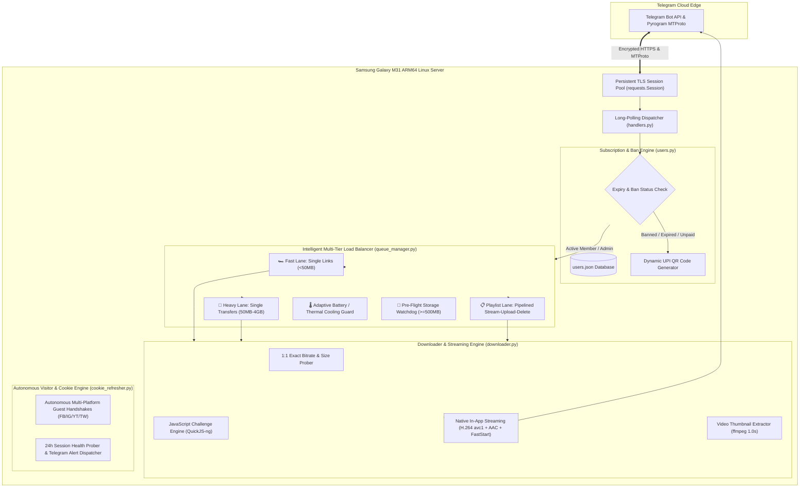

# 🏗️ EternalAutomationBot — Architecture & Technical Design

> **Deep technical documentation covering the modular architecture, multi-threaded downloader engine, native in-app streaming codecs, pipelined playlist engine, multi-tier queue manager, and Telegram callback query dispatcher.**

---

## 🧭 System Topology & Architecture

EternalAutomationBot operates as a **24/7 dedicated Linux ARM micro-service** running on a **Samsung Galaxy M31** with **Cloudflare Zero Trust Tunnel** security and multi-threaded asynchronous processing.



---

## 🧩 Core Subsystems

### 1. Modular Codebase Architecture
The codebase is structured into isolated, purpose-built micro-modules:
- `config.py`: Environment validation, paths, locks, thread pools (expanded to 8 workers), and global `cookies.txt` discovery.
- `telegram_api.py`: Low-level Telegram HTTP API wrappers with `requests.Session`, exponential backoff for 429 rate limits, and safe `escape_html` utility (HTML parse mode).
- `users.py`: Atomic database persistence (`users.json.tmp` -> `users.json`), caching, referrals, expiry reminders, subscription management, and complete Admin Ban management (`ban_user`, `unban_user`, `is_user_banned`, `get_banned_users`).
- `downloader.py`: Multi-platform adaptive streaming, SSRF protection, URL safety validators, direct album scrapers (Threads HD, Facebook 50+ albums with cluster isolation), JS challenge solver integration (`QuickJS-ng` + `ejs:github`), video preview thumbnail extractor (`ffmpeg`), native H.264/AAC codec synthesis with `-movflags +faststart`, 1:1 stream size calculation, long text chunking (`split_telegram_text`), and flat playlist extraction (`extract_playlist_entries`).
- `mtproto_uploader.py`: High-speed Pyrogram MTProto engine supporting up to 2GB (Bot Token) and 4GB (Telegram Premium) transfers with persistent on-disk sessions, passing video dimensions, durations, and thumbnails.
- `queue_manager.py`: Intelligent Multi-Tier Load Balancer & Health Guard (Fast Lane, Heavy Lane, Playlist Lane, dynamic thermal cooldowns based on `termux-battery-status`, and disk space watchdog).
- `cookie_refresher.py`: Autonomous multi-platform guest handshakes (Facebook `datr/sb`, Instagram `csrftoken/mid`, YouTube, Twitter), 24h session health prober, and Telegram alert dispatcher.
- `health.py`: Hardware telemetry alerts (Battery, Disk, RAM, CPU temperature).
- `handlers.py`: Message dispatching, command routing, payment approvals, interactive quality & cancellation buttons (`stop_<job_id>`), two-stage anti-spam flood protection, Admin ban commands, and pipelined playlist execution.
- `main.py`: Long-poll event loop, signal handling (`SIGINT`, `SIGTERM`), and automated periodic sweeps (cleanup, hardware health, expiry reminders, database backup, visitor handshakes, and cookie health alerts).

---

### 2. 100% Native In-App Telegram Streaming Architecture
To prevent the "Open in external player" prompt on Telegram mobile clients and guarantee instant streaming without buffering:
1. **Target Codec Synthesis (H.264 Full HD ≤1080p + AAC)**:
   Prioritizes native H.264 (`avc1`) video (capped at Full HD 1080p) and AAC (`mp4a`) audio in format selectors:
   ```python
   "bv*[vcodec^=avc1][height<=1080]+ba[acodec^=mp4a]/bv*[vcodec^=avc1][height<=1080]+ba/bv*[vcodec^=avc][height<=1080]+ba/bestvideo[height<=1080]+bestaudio/best"
   ```
   - **No Codec Downgrades**: Excluded `prefer_free_formats: True` so yt-dlp doesn't deprioritize H.264 in favor of VP9/WebM, which previously caused muxing failures and unexpected fallbacks to low-resolution streams.
   - **Resolution Lock**: Capped at `height<=1080` (Full HD) to prevent 4K/2160p stream bloat that stutters or fails native playback on mobile Telegram clients.
2. **1:1 Probe & Downloader Stream Alignment**:
   `probe_media_info()` strictly estimates sizes using H.264 (`avc1`) ≤1080p and AAC (`mp4a`) audio metadata, ensuring the format card button estimate (e.g. `~93 MB`) matches the downloaded file 1:1.
3. **FastStart Moov Atom Relocation**:
   Applies `-movflags +faststart` post-processing so video index headers are placed at the beginning of the MP4 file.
4. **Metadata Enrichment**:
   Runs `ffprobe` to determine duration, width, and height, passing `supports_streaming=True` into `sendVideo` and MTProto uploader.


---

### 3. Pipelined Stream-and-Upload Playlist Engine
Instead of bulk-downloading all 15–30 videos onto the phone storage at once (which consumed gigabytes and caused batch upload failures):
1. **Flat Entry Probing**: `extract_playlist_entries(url)` pulls the playlist item list in `< 1.5 seconds`.
2. **Interactive Choice**: User selects 🎬 **Video (MP4)** or 🎵 **Audio (MP3)**.
3. **Dual Real-Time Progress Tracking**:
   - Computes overall batch completion percentage: `[████░░░░░░] 4/15 Items (27%)`.
   - Simultaneously renders active track download bitrates/MB and MTProto/HTTP delivery progress.
4. **Pipelined Loop**:
   - Downloads Item 1 ➔ Uploads Item 1 immediately to Telegram ➔ Purges Item 1 from phone disk (`os.remove`) ➔ Downloads Item 2...
5. **Zero Phone Disk Buildup**: At any moment, only **at most 1 single file** exists on phone storage (< 50 MB), keeping the phone spacious and fast.

---

### 4. Intelligent Multi-Tier Load Balancer & Server Health Guard (`queue_manager.py`)
- **Multi-Lane Traffic Separation**:
  - **🏎️ Fast Lane (< 50 MB)**: Multi-worker concurrency for instant delivery of single links (Reels, TikToks, Shorts).
  - **🚂 Heavy Lane (50 MB – 4 GB)**: Serialized single-flight FIFO queue.
  - **📋 Playlist Lane**: Serialized batch queue ensuring only 1 active playlist runs at a time.
- **Dynamic Thermal Pacing**:
  - Checks live battery temperature via `get_server_metrics()`:
    - Normal (< 38°C): 1.0s pacing pause.
    - Warm (38°C–42°C): 2.0s pacing pause.
    - Hot (> 42°C): 4.0s cooling pause + forced Python garbage collection (`gc.collect()`).
- **👑 Admin Instant Bypass**: Admin requests bypass all queue locks and execute instantly.

---

### 5. Autonomous Cookie & Guest Handshake Engine (`cookie_refresher.py`)
- **Guest Device Handshakes**: Autonomously requests guest tokens for YouTube (`VISITOR_INFO1_LIVE`), Facebook (`datr`, `sb`), Instagram (`csrftoken`, `mid`, `ig_did`), and Twitter (`guest_id`, `gt`).
- **Session Preservation**: Merges fresh guest tokens into `cookies.txt` while preserving any authenticated account cookies (`c_user`, `xs`, `sessionid`).
- **Automated Health Prober**: Periodically tests Facebook and Instagram session endpoints. If a session expires or hits a login checkpoint, automatically notifies Admin on Telegram with actionable advice.

---

### 6. Security, Anti-Spam & Moderation
- **Scoped Command Dispatch & Interactive Admin Dashboard (`/admin`)**:
  - Employs Telegram's `BotCommandScopeChat(chat_id=OWNER_ID)` so administrative commands (`/admin`, `/users`, `/revenue`, `/health`, `/cookies`, `/backup`, `/banned`, `/broadcast`, `/ban`, `/unban`, `/reply`) are exposed exclusively to the owner and completely hidden from regular users.
  - Interactive `/admin` panel renders inline button callbacks (`adm_users`, `adm_revenue`, `adm_health`, `adm_cookies`, `adm_backup`, `adm_banned`) for 1-tap operation with zero command memorization.
- **Two-Stage Anti-Spam Guard**:
  - **Stage 1 (Burst Protection)**: Rejects > 4 requests in 15 seconds.
  - **Stage 2 (Hourly Quota)**: Enforces sliding window limits per 60 minutes.
- **Admin User Ban Management**:
  - `/ban <user_id> [reason]`, `/unban <user_id>`, `/banned`.
  - Inline 1-tap `[ 🚫 Ban User ]` button in support tickets.
- **SSRF & Address Validation**: Resolves hostnames and rejects private/loopback/reserved IPv4/IPv6 networks.
- **Path Traversal & Clean Cancellation**: `stop_` callback validates job IDs with regex (`^[a-zA-Z0-9_-]+$`), terminates in-flight extraction, and purges transient job directories without firing generic error messages.


---

### 7. Multi-Bot Lifecycle & Termux:Boot Auto-Recovery (`scripts/`)
- **🛑 Pre-Reboot Shutdown Orchestrator (`pre_reboot_shutdown.sh`)**:
  - Centralized coordinator that cleanly terminates all 3 running bot suites (`eternal-automation-bot`, `eternal-feed-bot`, `eternal-heartcast-bot`) via `SIGINT`/`SIGTERM`.
  - Waits up to 10 seconds for active downloads to drain.
  - Atomically validates database integrity across all bot instances and purges transient files before syncing filesystem buffers (`sync`).
- **🚀 Termux:Boot Autonomous Recovery Suite (`termux_boot.sh` -> `~/.termux/boot/`)**:
  - Automatically triggers on Android cold boot or scheduled hardware reboot without screen unlock.
  - Acquires `termux-wake-lock`, starts `crond` supervisor, and polls 4-tier network interfaces (socket / DNS / HTTP) until connectivity is established.
  - Spawns isolated `tmux` sessions (`bot`, `feed-bot`, `heartcast`) running respective `start.sh` watchdog runners.
- **⏰ Scheduled Maintenance (Cron)**:
  - Automates pre-reboot shutdown at 02:55 AM (5 minutes before Samsung One UI's 03:00 AM weekly reboot).
- **📱 Post-Boot Telemetry (`post_boot_notify.py`)**:
  - Dispatches a consolidated status alert to Admin with phone server uptime, battery stats, temperature, RAM, disk, and live multi-bot process telemetry.

---

### 8. Direct Social Scrapers & High-Precision Media Extractors (`downloader.py`)

To deliver content completely and reliably when standard generic scrapers fail:

1. **Threads Direct HD SSR Scraper (`extract_threads_media`)**:
   - **Googlebot SSR Bypass**: Bypasses client-side React hydration fences by simulating Googlebot requests, yielding fully pre-rendered server-side HTML.
   - **HD Video Stream Resolution**: Accurately extracts high-bitrate MP4 URLs from `<video src="...">` and `meta[property="og:video"]`.
   - **Multi-Part Text Chunking**: Cleans text artifacts and splits long post contents via `split_telegram_text` so users receive the full post message alongside the HD video.

2. **Facebook Photo Sets & Cluster-Prefix Boundary Isolation (`extract_facebook_media`)**:
   - **GraphQL & Subattachment Traversal**: Expands multi-photo albums and carousels, collecting all high-resolution images (`all_subattachments`, `media/set/`).
   - **7-Digit Cluster-Prefix Matching (`id_cluster_prefix = known_ids[0][:7]`)**: Facebook photo IDs within the same user post/album share identical leading ID prefixes. Enforcing cluster prefixes prevents pagination from overshooting into adjacent feed posts while enabling full extraction of 50+ image albums.
   - **Single Photo Posts**: Supports dedicated single-photo extractors for post URLs with individual image assets.

3. **Facebook Mobile Share Token Resolution & Ad Video Elimination**:
   - **Mobile Redirect Resolution**: Links with `/share/r/`, `/share/p/`, or `/share/v/` are resolved using HTTP `HEAD`/`GET` requests.
   - **Canonical Destination Routing**: The destination URL is re-evaluated (`/posts/`, `/photos/`, `/p/` vs `/reel/`, `/videos/`). This ensures photo posts that were assigned `/share/r/` tokens are never routed into video downloaders.
   - **Ad & Sponsored Element Exclusion**: Search scopes are tightly bounded to post-specific element containers, eliminating unrelated sponsor videos or banner artifacts.

4. **Intelligent Caption & Long Text Delivery (`split_telegram_text`)**:
   - Safely parses long social media posts exceeding Telegram's 1,024 caption limit or 4,096 message limit.
   - Preserves formatting and splits along natural boundaries (paragraphs `\n\n`, sentences `.\n`, spaces).
   - Long captions are sent as clear, readable companion text messages immediately accompanying the media album.

---

### 9. Dual-Repository Public Release & Sanitization Architecture (`sync_public.sh`)

To enable open sharing while keeping production infrastructure secure, the codebase is partitioned into a dual-repository model:

1. **Private Production Engine (`eternal-automation-bot`)**:
   - Contains operational credentials, live subscriber records (`users.json`), server connection parameters, Cloudflare Zero Trust tunnel endpoints, and admin dispatchers.
   - Deployed directly to the Samsung Galaxy M31 phone server (`ssh phone`).

2. **Public Open-Source Release (`eternal-automation-downloader`)**:
   - Hosted publicly on GitHub: [`https://github.com/EternalStud/eternal-automation-downloader`](https://github.com/EternalStud/eternal-automation-downloader).
   - Clean git history with a single orphan initial commit, stripping historical commit metadata and author email logs.
   - Neutral configuration defaults with environment variable fallbacks for `BOT_TOKEN`, `OWNER_ID`, `UPI_ID`, and `ADMIN_HANDLE`.

3. **Automated Sanitization Pipeline (`scripts/sync_public.sh`)**:
   - Synchronizes Python source modules, scripts, tests, and user documentation.
   - Purges personal Telegram IDs, handles, UPI accounts, and server hostnames.
   - Executes verification test suites before staging or pushing to GitHub.
   - Supports 1-command updates: `bash scripts/sync_public.sh --push "Commit message"`.


