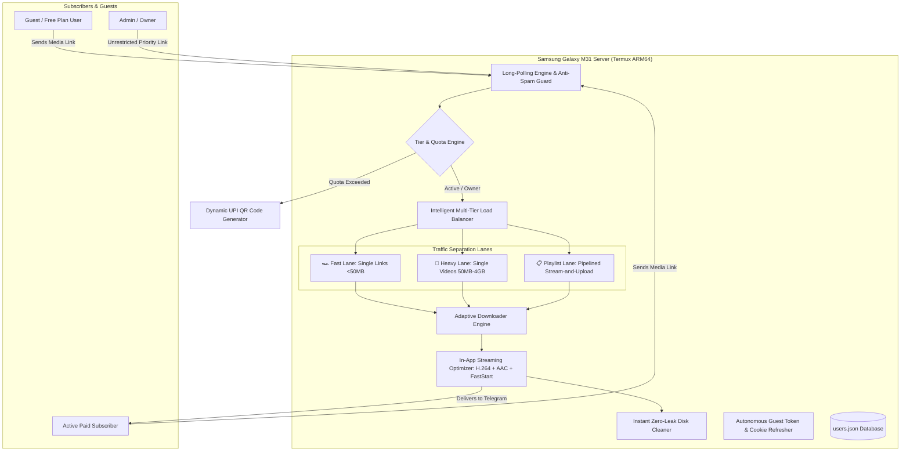

# 🤖 EternalAutomationBot (v2.0 Pro Enterprise)

> **A 24/7 high-speed social media downloader, micro-SaaS subscription bot, and Telegram channel moderation engine hosted on a dedicated Samsung Galaxy M31 ARM64 Linux Server with Cloudflare Zero Trust.**

---

## 📖 Overview

**EternalAutomationBot** is a production-grade Telegram automation platform and micro-SaaS media downloader. Built with Python 3.14.6 ARM64, `yt-dlp`, Pyrogram MTProto, and multi-threaded asynchronous workers, it runs **24/7 on a dedicated Samsung Galaxy M31 Linux ARM server at ₹0/month infrastructure cost**.

The bot provides **instant, ad-free, high-definition video downloads** across all major social media platforms, **100% native in-app Telegram video streaming (H.264 + FastStart)**, an **interactive pipelined playlist engine (zero phone storage buildup)**, automated **₹20/month subscription management** with **dynamic UPI QR codes**, and **enterprise-grade admin moderation with 1-tap user bans**.



---

## ✨ Key Features & Architectural Highlights

### 📥 1. Multi-Platform Ultra-Fast HD Downloader (Up to 4 GB)
- **4 GB MTProto High-Speed Engine (`mtproto_uploader.py`)**: Direct Pyrogram MTProto uploader supporting up to **2 GB (Bot Token)** and **4 GB (Telegram Premium Account)** transfers with persistent on-disk sessions.
- **🎬 100% Native Telegram In-App Streaming (`H.264 + AAC + FastStart`)**:
  - Automatically formats videos into native **H.264 (`avc1`)** Full HD (≤1080p) video and **AAC (`mp4a`)** audio codecs without re-encoding overhead.
  - Applies `ffmpeg` `-movflags +faststart` post-processing to place index metadata (`moov` atom) at the file header for instant video streaming without buffering.
  - Extracts duration, width, and height using `ffprobe` to pass `supports_streaming=True` directly into the Telegram player.
- **📋 Pipelined Stream-and-Upload Playlist Engine (`downloader.py` & `handlers.py`)**:
  - **Sub-Second Probing**: Extracts playlist metadata and item entries in `< 1.5 seconds` using flat metadata parsing.
  - **Interactive Format Selection**:
    - `[ 🎬 Download All as Video (MP4) ]`
    - `[ 🎵 Download All as Audio (MP3) ]`
    - `[ ❌ Cancel ]`
  - **Dual Real-Time Progress Tracking**: Displays a live progress bar for the overall playlist (`[████░░░░░░] 4/15 Items (27%)`) simultaneously alongside individual track download and delivery progress bars.
  - **Zero Disk Buildup Execution**: Downloads Item 1 ➔ Uploads Item 1 immediately to Telegram ➔ Purges Item 1 from phone disk (`os.remove`) ➔ Downloads Item 2... Keeping phone storage at near **0 MB used** throughout the entire batch!
- **🎯 1:1 Accurate Size Probing & Codec Alignment**:
  - `probe_media_info()` and `download_media()` are synchronized to target the identical H.264 (`avc1`) ≤1080p stream and AAC (`mp4a`) audio stream.
  - Button preview estimates match actual downloaded files 1:1 without artificial multipliers or codec-muxing mismatches.

- **🛡️ Intelligent Multi-Tier Load Balancer & Thermal Protection (`queue_manager.py`)**:
  - **🏎️ Fast Lane (< 50 MB)**: Multi-worker concurrency for instant Reels, Shorts, TikToks, and MP3s (delivers in 3–5 seconds).
  - **🚂 Heavy Lane (50 MB – 4 GB)**: Serialized single-flight FIFO queue with live position tracking (`⏳ Position #1`).
  - **📋 Playlist Lane**: Serialized batch queue ensuring only 1 active playlist runs at a time to protect device bandwidth.
  - **🌡️ Dynamic Battery & Thermal Throttling**: Monitors real-time hardware temperatures via `termux-battery-status` and inserts adaptive cooling pauses (1.0s to 4.0s) between batch items to keep the Samsung phone cool and fast.
  - **💾 Pre-Flight Storage Watchdog**: Verifies that `>= 500 MB` of free disk space is available before downloading any chunk.
- **🛑 Clean Real-Time Stop / Cancel Download (`[ 🛑 Stop / Cancel Download ]`)**:
  - Halts in-flight single or batch downloads immediately, clearing temporary files and displaying a clean polite cancellation confirmation without generic error prompts.
- **✨ Smart Reel Naming & Noise Stripping**:
  - Automatically detects and purges ugly view/reaction counts (`179K views · 213K reactions`) from Instagram/Facebook reel metadata.
  - Automatically extracts clean captions, creator handles, and human-readable filenames (e.g. `Reel by @creator.mp4`).
- **🖼️ Video Preview Thumbnails & FastStart**:
  - Automatically extracts a crisp thumbnail at 1.0s using `ffmpeg`, eliminating black video boxes in mobile Telegram apps.
  - Applies `-movflags +faststart` to place `moov` atom at the file header for instant in-app playback.
- **🧵 Threads Direct HD Video & Post Scraper (`extract_threads_media`)**:
  - Direct Googlebot SSR bypass extracts full high-bitrate HD MP4 video streams and post text natively in `< 1.0s`.
  - Automatically fetches all post content without reliance on broken third-party APIs or authentication barriers.
  - Formats multi-paragraph post text cleanly into Telegram message chunks.
- **📸 Facebook High-Precision Album & Multi-Media Engine (`extract_facebook_media`)**:
  - **50+ Photo Album Extraction**: Traverses multi-photo GraphQL sets and carousels, delivering full albums (50+ photos) in sequential Telegram photo batches.
  - **7-Digit Cluster-Prefix Scoping (`id_cluster_prefix`)**: Enforces strict media cluster matching (`known_ids[0][:7]`) to eliminate boundary leakage into adjacent timeline posts or unrelated friend feeds.
  - **Full Long-Text Post Delivery**: Extracts complete, untruncated post captions from GraphQL `message.text` and splits long narratives cleanly via `split_telegram_text()` into sequentially delivered Telegram messages (up to 4,096 characters per chunk).
  - **Mobile Share Token Resolution**: Resolves short/mobile share links (`/share/r/`, `/share/p/`, `/share/v/`, `fb.watch`) via HTTP `HEAD`/`GET` redirects and recalculates `is_reel` on the canonical URL—preventing multi-photo posts from misrouting to video extractors and eliminating extraneous ad video downloads.
- **Supported Platforms**:
  - 🔴 **YouTube & Shorts** (Full HD 1080p, Playlists & MP3s)
  - 📸 **Instagram** (Reels, Posts, Stories & Carousels grouped as Albums)
  - 🔵 **Facebook** (Reels, 50+ Photo Albums, Single Photos & Long Posts)
  - 🧵 **Threads** (Direct HD MP4 Videos, Photos & Full Post Text)
  - 🐦 **X (Twitter)** · 📌 **Pinterest** · 🎵 **TikTok** · 👾 **Reddit** · 🎧 **SoundCloud**

---

### 🍪 2. Autonomous Multi-Platform Visitor Handshake & Cookie Watchdog

- **🤖 Autonomous Multi-Platform Guest Handshakes (`cookie_refresher.py`)**:
  - Autonomously performs guest device handshakes for **YouTube** (`VISITOR_INFO1_LIVE`), **Facebook** (`datr`, `sb`, `wd`), **Instagram** (`csrftoken`, `mid`, `ig_did`, `datr`), and **Twitter/X** (`guest_id`, `gt`).
  - Automatically merges fresh visitor tokens into `cookies.txt` every 12 hours while strictly preserving authenticated user session cookies.
- **🩺 Automated Platform Cookie Session Health Watchdog**:
  - Actively probes Facebook and Instagram endpoints every 24 hours to verify if session cookies are alive.
  - Automatically alerts the Admin on Telegram if an expired session or login checkpoint is detected.
- **Instant Admin Commands**: `/cookies`, `/cookiehealth`, and `/checkcookies` display live platform status and allow instant `cookies.txt` updates via Telegram file drag & drop.

---

### 👑 3. Admin Privileges & Enterprise Moderation

- **🎛️ Scoped Telegram Commands & Interactive Admin Dashboard (`/admin`)**:
  - **Scoped Menu**: Admin commands are registered exclusively for `OWNER_ID` via Telegram's `BotCommandScopeChat` (`/admin`, `/users`, `/revenue`, `/health`, `/cookies`, `/backup`, `/banned`, `/broadcast`, `/ban`, `/unban`, `/reply`). Regular users never see admin commands in their `/` command menu.
  - **1-Tap Interactive Dashboard (`/admin`)**: One-click inline keyboard buttons for instant stats, revenue, hardware diagnostics, cookies, backups, and ban lists—zero command memorization needed!
- **100% Unrestricted Admin Access**:
  - Exempt from hourly limits, monthly quotas, and queue wait times with up to 4 GB MTProto file size and 250-item playlists.
- **🚫 Complete User Ban Management**:
  - `/ban <user_id> [reason]`: Permanently suspends user access with 0 resource consumption.
  - `/unban <user_id>`: Restores user access immediately.
  - `/banned`: Lists all currently banned users with dates and reasons.
  - **1-Tap Inline Quick-Ban Button**: Included in support tickets and alert cards.
- **⚡ Two-Stage Anti-Spam & Burst Flood Protection**:
  - **Stage 1 (Rapid Burst)**: Detects flooding (> 4 links in 15s) and warns the user to slow down.
  - **Stage 2 (Hourly Quota)**: Enforces `MAX_DOWNLOADS_PER_HOUR` sliding window limits.


---

### 💰 4. Micro-SaaS Subscription & Tiered Limits

| User Role | Max Playlist Items | Max File Size | Quality Pipeline | Monthly Quota |
| :--- | :--- | :--- | :--- | :--- |
| **🎁 Free Plan** | Up to remaining quota (max 5) | 50 MB / video | HTTP Fast Lane | 10 downloads OR 1.0 GB bandwidth / month (whichever is reached first) |

| **💎 Paid Subscriber (₹20/mo)** | **10 items / batch** | Up to 2,000 MB (2 GB) | MTProto Ultra Pipeline | Unlimited 24/7 Access |
| **👑 Admin / Owner** | **Up to 250 items** | Up to 4,000 MB (4 GB) | MTProto 4GB Priority | Unlimited Lifetime |

- **Dynamic UPI QR Code Generation**: Unauthorized users instantly receive a custom QR code pre-filled with the exact fee and User ID reference.
- **1-Click In-Bot Payment Approvals**: Admins approve or reject payment screenshots with interactive inline buttons (`[ ✅ Approve (30 Days) ]` / `[ ❌ Reject ]`).
- **Automated Referral System**: Every successful referral earns the referrer **+7 Free Days** of Unlimited Access.

### 🔄 5. Multi-Bot Lifecycle, Pre-Reboot Sync & Termux:Boot Auto-Recovery

- **🛑 Pre-Reboot Graceful Shutdown Orchestrator (`scripts/pre_reboot_shutdown.sh`)**:
  - Broadcasts graceful termination signals to all active bots (`eternal-automation-bot`, `eternal-feed-bot`, `eternal-heartcast-bot`).
  - Drains in-flight network & download tasks cleanly within a 10s window.
  - Verifies multi-bot JSON database integrity (`users.json`, `state.json`, `channel_seen_posts.json`) before shutdown.
  - Cleans transient download chunks, lock files, and flushes filesystem caches (`sync`).
- **🚀 Autonomous Termux:Boot Recovery Suite (`scripts/termux_boot.sh` -> `~/.termux/boot/`)**:
  - Automatically executes on Android phone boot without requiring screen unlock.
  - Acquires `termux-wake-lock` to keep background CPU running without sleep throttling.
  - Layered 4-tier network poller waits for Wi-Fi / 4G connection before launching.
  - Automatically spins up all 3 isolated `tmux` sessions (`bot`, `feed-bot`, `heartcast`) with their watchdog loops.
- **⏰ Scheduled Weekly Pre-Reboot Maintenance (`scripts/setup_cron.sh`)**:
  - Runs at **02:55 AM** (5 minutes prior to Samsung One UI's 03:00 AM Auto-Restart window) to cleanly shut down bots and preserve state.
- **📱 Post-Boot Telemetry & Telegram Admin Notification (`scripts/post_boot_notify.py`)**:
  - Dispatches consolidated system health report to Admin on reboot (Phone Uptime, Status of all 3 bots, Battery %, Temp °C, RAM %, Disk space).

---

## 🎮 Command Reference


### 👤 Subscriber & Member Commands
| Command | Description |
|---|---|
| `/start` | Welcome message, platform guide, and active subscription status |
| `/whoami` | Displays profile, User ID, handle, and remaining days or free quota |
| `/ping` | Health-check; returns server latency and online confirmation |
| `/support <msg>` | Sends a direct customer support ticket to the Admin |
| `/refer` | Generates personal referral link (+7 Free Days per referral) |
| `/renew` | Generates instant UPI QR code for ₹20/month subscription |
| `<URL>` | Paste any supported video link for instant processing and delivery |

### 👑 Admin / Owner Commands
| Command | Description |
|---|---|
| `/ban <id> [reason]` | Permanently suspends a user and blocks all requests |
| `/unban <id>` | Restores a banned user's account |
| `/banned` | Lists all banned users with timestamps and reasons |
| `/checkcookies` | Live diagnostics of Facebook, Instagram, and YouTube session cookies |
| `/cookies` | View cookie health and receive `cookies.txt` file |
| `/addsub <id> [days]` | Grants or renews subscription and notifies the user |
| `/deluser <id>` | Instantly revokes / removes a user from database |
| `/users` | Formatted list of Active and Expired subscribers |
| `/revenue` | Shows total payments, ARR, and trial conversion rates |
| `/backup` | Directly sends a copy of `users.json` to Admin |
| `/broadcast <msg>` | Sends a global broadcast message to all users |
| `/health` | Live phone hardware telemetry (Battery, CPU, Memory, Disk) |

---

## 🗂️ Project Structure

```
├── config.py             # Environment loading, shared constants, thread pools
├── telegram_api.py       # HTTP session wrapper, HTML escaping utilities
├── users.py              # Atomic JSON persistence, subscription, referrals & ban manager
├── downloader.py         # 5-tier adaptive yt-dlp, H.264 streaming codecs, playlist extraction
├── mtproto_uploader.py   # High-speed Pyrogram MTProto engine (up to 4 GB transfers)
├── queue_manager.py      # Multi-tier load balancer, playlist lane & thermal cooling guard
├── cookie_refresher.py   # Autonomous visitor handshakes & platform session health prober
├── health.py             # Server telemetry, proactive hardware alerts
├── handlers.py           # Command routing, anti-spam, playlist pipelining & job isolation
├── main.py               # Event loop, periodic sweeps, lifecycle management
├── start.sh              # 24/7 bash watchdog, log rotation, environment checks
├── scripts/
│   ├── pre_reboot_shutdown.sh # Multi-bot graceful shutdown & DB flush
│   ├── termux_boot.sh         # Termux:Boot autonomous auto-startup suite
│   ├── setup_cron.sh          # Pre-reboot maintenance crontab installer
│   └── post_boot_notify.py    # Post-boot health telemetry & Telegram notification
├── users.json            # Persistent subscriber database (Auto-backed up)
├── cookies.txt           # Multi-platform authenticated cookie store
├── state.json            # Long-polling persistence to prevent message drops
└── README.md             # Project Overview
```


---

## 🚀 Quick Start (Linux / VPS / Termux)

### 1. Clone & Install Dependencies
```bash
git clone https://github.com/EternalStud/eternal-automation-downloader.git
cd eternal-automation-downloader

# Install Python packages
pip install -r requirements.txt

# Ensure ffmpeg is available
# Ubuntu/Debian: sudo apt install -y ffmpeg
# Termux: pkg install -y ffmpeg
```

### 2. Configure Environment
```bash
cp .env.example .env
nano .env
```
Fill in your credentials:
```env
BOT_TOKEN=123456789:ABCdefGhIJKlmNoPQRsTUVwxyZ
OWNER_ID=YOUR_TELEGRAM_USER_ID
ADMIN_HANDLE=@YourUsername
UPI_ID=yourname@bank
```

### 3. Launch 24/7 Watchdog Runner
```bash
bash start.sh
```

Or run inside a persistent `tmux` session:
```bash
tmux new-session -d -s bot 'bash start.sh'
tmux attach -t bot
```

---

## 📄 License

This project is licensed under the [MIT License](LICENSE).
Maintained by **EternalStud** · Part of the **Eternal Automation** ecosystem.

